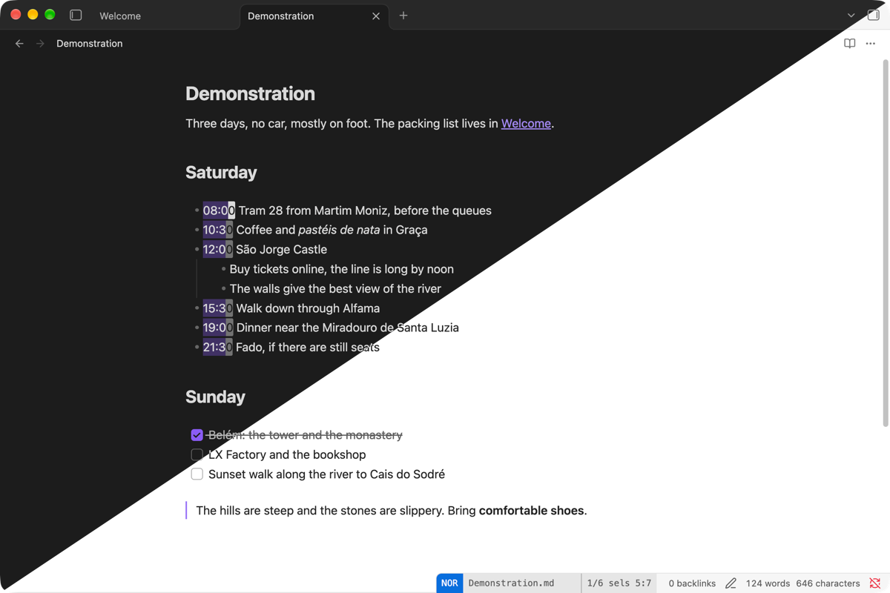

# Helix Motions

Helix Motions brings [Helix](https://helix-editor.com) editing to Obsidian. It is ported from Helix's source and tested against real Helix.



- Use Helix's keymap, selections, multiple cursors, registers, macros, undo tree, text objects, surround and jump labels.
- Copy your Helix config into your vault, and it works.
- Reach Obsidian through Helix's keys: `Space f` opens the quick switcher, and `gd` follows a link.
- Move through Live Preview tables, with cursors across cells and cell selections.

More in [docs/screenshots](docs/screenshots), each in dark, light and both.

## Installation

1. Open **Settings → Editor**, and turn off **Vim key bindings**. Turn off other Vim plugins.
2. Open **Settings → Community plugins**.
3. Select **Browse**, then search for **Helix Motions**.
4. Select **Install**, then **Enable**.

Requires Obsidian 1.15 or later, on desktop.

To install manually, download `main.js`, `manifest.json` and `styles.css` from the latest release into `<vault>/.obsidian/plugins/helix-motions/`.

## Usage

Press `Space` or `g` to see the keys in a menu. Everything else works as it does in Helix.

To change keys and options, open **Settings → Helix Motions**. The editor there has Helix keys, and edits `helix.toml` in the root of your vault:

```toml
[editor]
scrolloff = 3
color-modes = true

[keys.normal]
"C-s" = ":write"

[keys.normal.space]
o = "switcher:open"
```

Helix's own commands keep their names. Any Obsidian command works too, by its id.

## Documentation

- [Configure Helix Motions](docs/config.md)
- [Helix in Obsidian](docs/helix-in-obsidian.md)
- [Tables](docs/tables.md)
- [Obsidian commands](docs/obsidian-commands.md)
- [Appearance](docs/appearance.md)
- [Privacy and capabilities](docs/capabilities.md)

## Compatibility

Helix Motions follows Helix at commit `ba40e54742`. Every Helix editing command is here. Commands that need a shell, a language server or a debugger are not, and show a message instead. [docs/scope.md](docs/scope.md) lists every command and option.

The Helix engine is [helix-cm6](https://tangled.org/kote-pdj.bsky.social/helix-cm6). About 44,000 key sequences run in real Helix and in the engine, and the text, the selections and the mode after each one must match exactly.

## Develop

See [Contributing](CONTRIBUTING.md) and [Testing](docs/testing.md).

## Credits

The Helix engine is ported from [Helix](https://github.com/helix-editor/helix) at commit `ba40e54742`, under the Mozilla Public License 2.0, including the injection layers of [tree-house](https://github.com/helix-editor/tree-house). Syntax trees come from [tree-sitter](https://github.com/tree-sitter/tree-sitter) and [tree-sitter-markdown](https://github.com/tree-sitter-grammars/tree-sitter-markdown) (MIT). The way to end IME composition in normal mode comes from [codemirror-vim](https://github.com/replit/codemirror-vim).

## License

[MPL-2.0](LICENSE)
