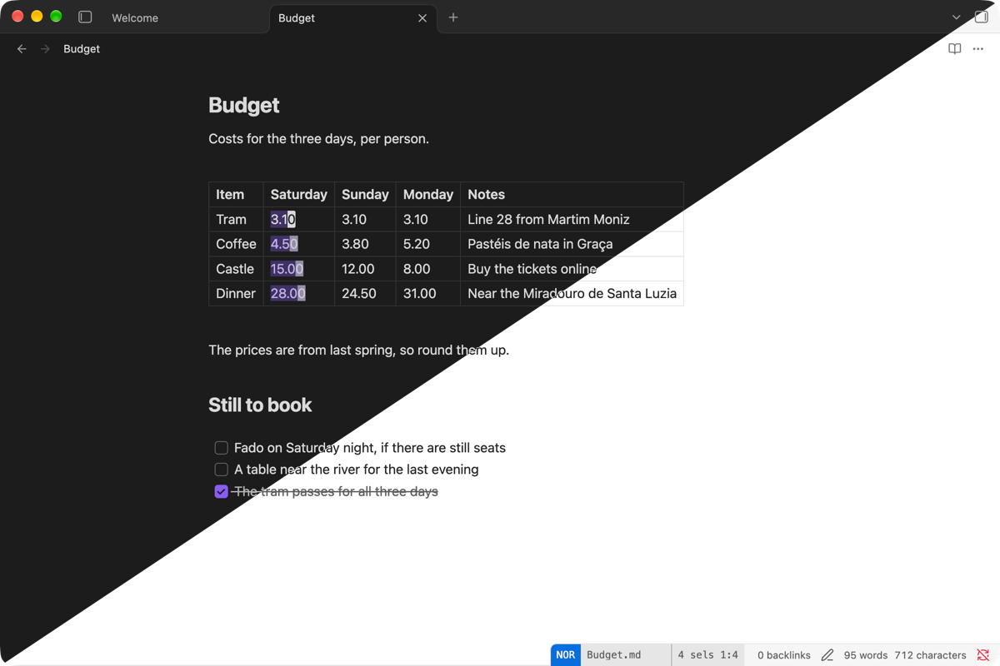
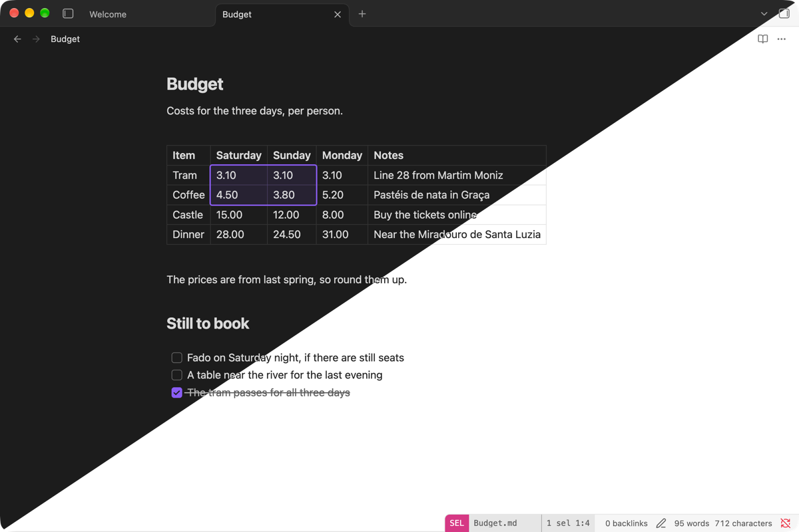

# Tables

In Source mode a table is text, and every Helix command works on it as text. In Live Preview a table has two levels: text and cells.

## Edit text in a cell

The cursor is in a cell, and the cell acts as a one-line document.



| Keys | What they do |
| --- | --- |
| `mi\|` | Select the cell's text. |
| `e`, `b`, `w` and their long forms | Work in the cell, then go on to the next or previous cell, row and out of the table. |
| `h`, `l` | Cross cells, and stay in the row. |
| `j`, `k` | Go up or down in the same column, by visual row in a wrapped cell. |
| `gh`, `gl`, `I`, `A`, `f`, `t` | Stay in the cell. |
| `/`, `n`, `%`, `gg`, `ge`, `u` | Act on the note. |
| `o`, `O` | Add a row and start typing. |
| `J` | Nothing, because joining rows breaks the table. |
| `C`, `Alt-C` | Add a cursor in the same column in another row. Keys then run in every cell, and each cursor crosses cells on its own, as above. Cursors stop at the table's edge and merge there. `,` goes back to one cursor. |

## Select cells

This level uses Obsidian's own cell selection. To reach it:

- `ma|` selects a cell.
- `x` selects rows.
- `mip` and `map` select the table.
- In select mode, extending past the edge of the cell's text selects the cell. Further motions add cells.
- A mouse drag also works.



| Keys | What they do |
| --- | --- |
| `h`, `j`, `k`, `l`, `w`, `b`, `e` | Move by cells. In select mode they extend the selection. |
| `d` | Use Obsidian's delete: whole rows or columns go, the whole table goes, and otherwise the text is cleared. |
| `c` | Clear the cells and type in all of them. |
| `i`, `a` | Type at the start or end of every selected cell. |
| `mi\|` | Put one cursor in each cell, with its text selected. |
| `s`, `S`, `K`, `Alt-K` | Select, split or filter inside the selected cells, as a regex on each cell's text. |
| `y`, `p` | Copy and paste as a table block. |
| `x` | Grow to whole rows, then add rows. |
| `C`, `Alt-C` | Add a row to the selection. |
| `;`, `,`, `Esc` | Go back to a cursor in the cell. |

## Select across a table

A selection that starts outside the table treats it as lines. It runs over whole rows, and the covered rows are marked. The hidden `|---|` line goes with the header.

## Search the note

`/`, `n` and `%` then `s` work on the whole note. A match in a cell is selected in that cell. When there are several, each one in a cell treats the cell as its whole document and stops at the table's edge, and the others act as in any note. `x` selects whole rows.

Edits that would break a row are refused: several lines into a cell, an indent, or a delete across a cell's edge. A typed `|` is escaped.

## Keys in insert mode

`Tab`, `Shift+Tab` and `Enter` stay Obsidian's: next cell, previous cell, cell below, and a new row at the end.

## Change columns and rows

Columns and moving rows are Obsidian commands. Bind the `editor:table-*` ids from [Obsidian commands](obsidian-commands.md):

```toml
[keys.normal]
A-t = "editor:table-col-after"
```

## Known limits

- A row with too few cells stops at its last cell.
- A malformed table follows Obsidian's grid.
- A table in a callout, quote or list uses text motions, because Obsidian opens no cell editor there.
- An escaped `\|` shows as raw text in a rendered cell.
- Other cells show rendered text, so a cursor on hidden markup such as `**` is drawn on the next visible character.
